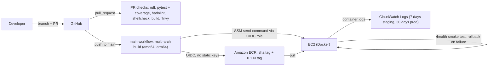
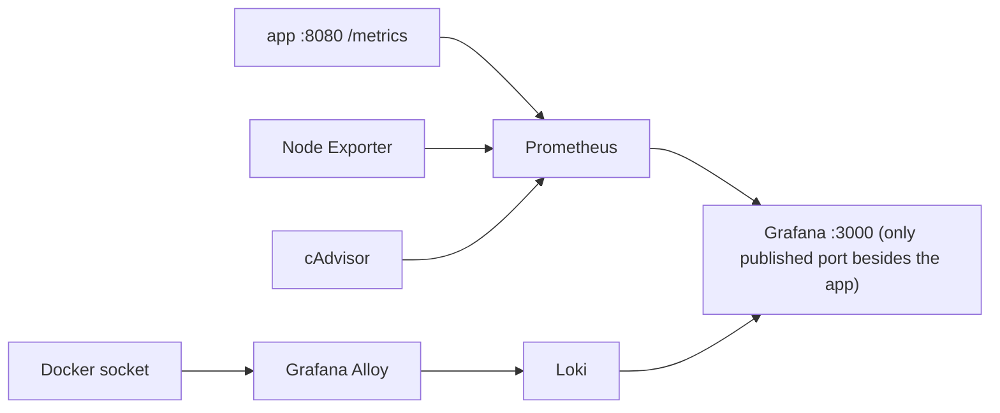
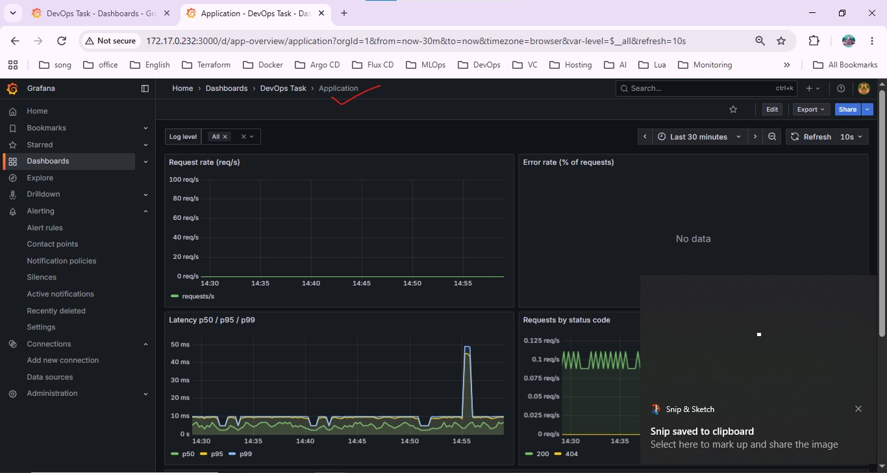
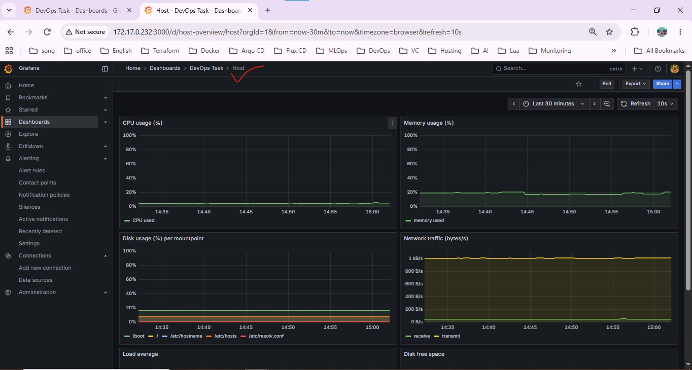
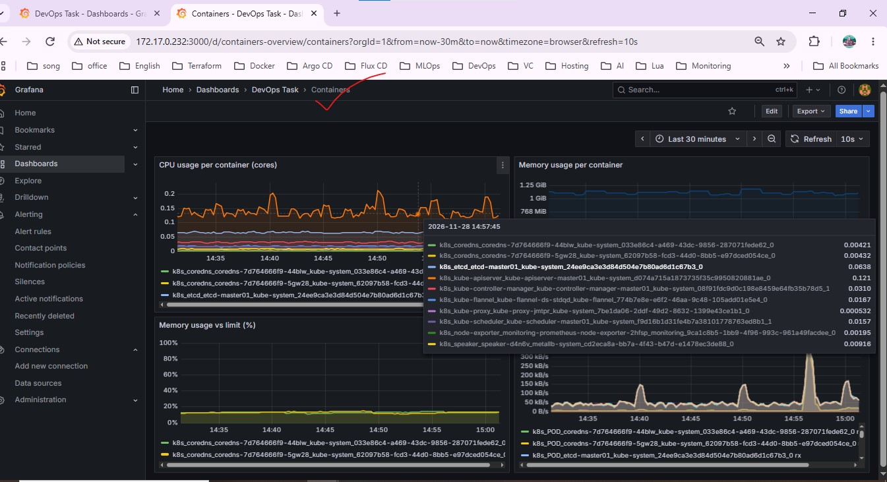
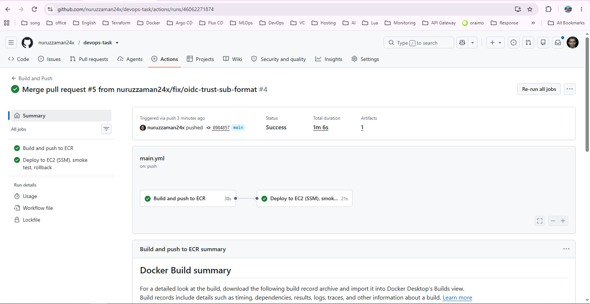

# DevOps Task: FastAPI service, CI/CD, Terraform, Kubernetes, Observability

A small FastAPI service taken from source to a containerised, scanned, deployed and monitored state.

| Area | Where |
|---|---|
| App + tests | `app/`, `tests/` |
| Container | `Dockerfile`, `docker-compose.yml` |
| CI/CD | `.github/workflows/pr.yml`, `.github/workflows/main.yml` |
| Terraform | `terraform/` (`bootstrap/`, `ci-oidc/`, root module with `envs/*.tfvars`) |
| Kubernetes | `k8s/` |
| Observability | `docker-compose.monitoring.yml`, `monitoring/` |
| Health script | `scripts/system_health.sh`, `deploy/systemd/` |

## 1. Architecture



Kubernetes flow (local cluster): `kubectl apply -f k8s/` creates Namespace, ConfigMap, Deployment (2 replicas, rolling update), Service, Ingress (ingress-nginx) and HPA. The Secret is created separately with `k8s/create-secret.sh`.

Observability flow (Docker Compose, internal network `app-net`):



## 2. Prerequisites

- Docker with the Compose plugin
- Python 3.12 (only to run the tests outside Docker)
- `shellcheck` (to lint scripts)
- Terraform >= 1.10 and AWS CLI (only for the AWS part)
- A local Kubernetes cluster with ingress-nginx and metrics-server (only for the Kubernetes part)

## 3. Run the app locally

```bash
docker compose up --build
curl localhost:8080/          # {"message":"Hello from DevOps Task!","status":"running","version":"0.1.0"}
curl localhost:8080/health
curl localhost:8080/metrics
```

Configuration is read from environment variables: `PORT`, `LOG_LEVEL`, `APP_ENV`, `APP_VERSION`. Logs are JSON on stdout. On SIGTERM uvicorn shuts down gracefully and `/health` returns 503 while shutting down.

## 4. Run the observability stack

```bash
cp .env.example .env
# edit .env and set a real GRAFANA_ADMIN_PASSWORD (the file is git-ignored)
docker compose -f docker-compose.yml -f docker-compose.monitoring.yml up -d --build
docker compose -f docker-compose.yml -f docker-compose.monitoring.yml ps
```

Open Grafana at `http://localhost:3000` (user and password from `.env`). Dashboards are in the folder **DevOps Task**: Application, Host, Containers. Data sources and dashboards are provisioned from files under `monitoring/grafana/`, nothing is configured by hand.

Stop everything: `docker compose -f docker-compose.yml -f docker-compose.monitoring.yml down` (add `-v` to delete stored data).

### Dashboards

Application (request rate, error rate, p50/p95/p99 latency, status codes, Loki logs panel):



Host (CPU, memory, disk, network, load from Node Exporter):



Containers (per-container CPU and memory, memory vs limit from cAdvisor):



### Log labels (cardinality)

Alloy discovers containers through the Docker socket and creates only three labels: `container`, `service` and `level`. `level` has a handful of values (DEBUG, INFO, WARNING, ERROR), so it is safe as a label. `path`, `method`, `status` and `duration_ms` are deliberately **not** labels: their values are unbounded, and every distinct value would create a new Loki stream and bloat the index. They stay inside the JSON log line and are filtered at query time, for example:

```
{service="app"} | json | path="/nope" | status >= 400
```

### Retention

- Prometheus: 15 days (`--storage.tsdb.retention.time=15d`).
- Loki: 7 days (`retention_period: 168h`, compactor retention enabled). Seven days is enough for debugging a small service and keeps disk use predictable.

### Alert rules (`monitoring/prometheus/rules/alerts.yml`)

| Alert | Condition | for | Why |
|---|---|---|---|
| AppDown | `up{job="app"} == 0` | 1m | Scrape interval is 15s, so 1m is about 4 failed scrapes in a row. One lost scrape does not page. |
| HighErrorRate | 5xx ratio above 5% | 5m | A short spike is noise. 5% for 5 minutes means users are really affected. |
| HostDiskUsageHigh | filesystem above 80% (tmpfs and overlay excluded) | 10m | Disks fill slowly. 80% leaves time to react without flapping. |
| ContainerMemoryNearLimit | working set above 90% of limit (only containers with a limit) | 5m | Above 90% an OOM kill becomes likely. |

Rules are evaluated by Prometheus and visible on its Alerts page. There is no Alertmanager, so nothing is routed to Slack yet (see section 13).

### Host access granted to monitoring containers

| Container | Mounts (all read-only) | Why |
|---|---|---|
| Alloy | `/var/run/docker.sock` | Discover containers and read their logs. Note: socket access is powerful, even read-only. |
| Node Exporter | `/` as `/host` | Read host CPU, memory, disk and network counters. |
| cAdvisor | `/`, `/var/run`, `/sys`, `/var/lib/docker`, `/dev/disk` | Read cgroup and container metadata for per-container metrics. |

No container runs `privileged`. Only Grafana (3000) is published by the monitoring file. Prometheus, Loki, Alloy, Node Exporter and cAdvisor are reachable only on the internal Docker network. All image versions are pinned.

### Walkthrough: an error spike appears on the Application dashboard

1. On **Application**, note the time window of the spike in *Error rate* and look at *Requests by status code* to see which codes rose (500 vs 404).
2. Check *Latency p95/p99* for the same window. Rising latency before the errors points at saturation. Errors with normal latency point at a code bug.
3. In the *App logs (Loki)* panel on the same dashboard, set the *Log level* variable to ERROR (or WARNING) and read the lines inside the spike window. Each line contains `path`, `status` and `duration_ms`, so the failing endpoint is visible directly.
4. Narrow in Loki with `{service="app"} | json | path="/the-path"`.
5. Open **Containers** for the same window: memory close to the limit or CPU at its cap suggests an OOM or throttling cause. Check **Host** for disk, CPU or network pressure.
6. Check whether `AppDown` or `ContainerMemoryNearLimit` fired on the Prometheus Alerts page.

## 5. Tests

```bash
pip install -r app/requirements.txt -r tests/requirements-test.txt pytest-cov
python -m pytest tests/ --cov=app --cov-report=term-missing
```

CI fails the build if coverage is below 80%.

## 6. Container image

- Multi-stage build: dependencies are installed into a venv in the builder stage and only the venv and `main.py` are copied into the final stage.
- Base `python:3.12-alpine3.22` pinned by tag **and** digest.
- Runs as non-root user `appuser` (uid 10001, no login shell).
- `HEALTHCHECK`, OCI labels and a `.dockerignore` are included.
- **Image size:** 116 MB on disk (uncompressed), about 27.5 MB compressed (about 27 MB in ECR).

## 7. CI/CD (GitHub Actions)

**Pull request (`pr.yml`)**: ruff lint, pytest with coverage (fails under 80%) and coverage artifact, hadolint, shellcheck on `scripts/*.sh`, image build with layer cache, Trivy scan that fails on CRITICAL (`ignore-unfixed: true`).

**Push to main (`main.yml`)**:
1. Multi-arch build (linux/amd64 and linux/arm64) with GitHub Actions layer cache.
2. Tags: `sha-<full commit sha>` and `0.1.<run number>`. `latest` is not used.
3. Push to Amazon ECR using GitHub OIDC (no long-lived keys).
4. Deploy to the EC2 instance through SSM `send-command`, run a smoke test against `/health` (10 tries, 3s apart) and automatically redeploy the previous image tag if it fails.

### Required configuration

No secrets are needed. Four **repository variables** (Settings > Secrets and variables > Actions > Variables):

| Variable | Example |
|---|---|
| `AWS_REGION` | `ap-south-1` |
| `AWS_ROLE_ARN` | output `role_arn` of `terraform/ci-oidc` |
| `ECR_REPOSITORY` | `devops-task-staging` |
| `EC2_INSTANCE_ID` | output `instance_id` of the root Terraform module |

Evidence of a successful run on `main` (ECR push, SSM deploy, smoke test):



## 8. Terraform

Layout:
- `terraform/bootstrap/`: creates the S3 bucket for remote state (versioned, encrypted, public access blocked). Applied once, with local state.
- `terraform/ci-oidc/`: GitHub OIDC provider and the IAM role the pipeline assumes.
- `terraform/` (root): ECR repository (scan on push, keeps last 20 images), CloudWatch log group, security group, IAM role and instance profile, EC2 instance with user data that installs Docker.
- `terraform/envs/staging.tfvars` and `prod.tfvars`: one codebase for both environments, selected with `-var-file`.

Remote state uses S3 with native locking (`use_lockfile = true`, Terraform >= 1.10), encrypted.

```bash
cd terraform/bootstrap && terraform init && terraform apply   # once
cd ..
terraform init \
  -backend-config="bucket=devops-task-tfstate-<aws-account-id>" \
  -backend-config="key=<environment>/terraform.tfstate" \
  -backend-config="region=ap-south-1"
terraform plan  -var-file=envs/staging.tfvars
terraform apply -var-file=envs/staging.tfvars
terraform destroy -var-file=envs/staging.tfvars   # when finished, to stop costs
```

Security and least privilege:
- Security group exposes only the app port. No SSH: access is through SSM.
- The instance role has SSM core, ECR pull on its own repository only, and `logs:CreateLogStream` and `logs:PutLogEvents` on its own log group only. No static keys.
- IMDSv2 is required. The root volume is encrypted gp3.
- The CI role can be assumed only by this repository's `main` branch. It can push to `devops-task-*` ECR repositories and run `AWS-RunShellScript` on instances tagged with this project.
- GitHub now sends the OIDC `sub` claim with numeric owner and repo IDs, so the trust policy accepts both the old and the new format.

Evidence of `terraform apply` (screenshot or log) is not included in this repository.

## 9. Kubernetes (local cluster)

Manifests are plain YAML in `k8s/`: Namespace, ConfigMap, Deployment, Service (ClusterIP), Ingress (class `nginx`, host `devops-task.local.com`) and HPA.

Deployment: 2 replicas, `RollingUpdate` with `maxUnavailable: 0` and `maxSurge: 1`, readiness and liveness probes on `/health`, requests 50m CPU / 64Mi, limits 250m CPU / 128Mi, `preStop` sleep and 30s grace period. Security context: non-root uid 10001, `readOnlyRootFilesystem`, all capabilities dropped, no privilege escalation, `RuntimeDefault` seccomp, and an `emptyDir` on `/tmp`. HPA: CPU target 70%, 2 to 5 replicas.

```bash
kubectl apply -f k8s/namespace.yaml
./k8s/create-secret.sh                 # creates devops-task-secret (see below)
kubectl apply -f k8s/
kubectl -n devops-task get pods,svc,ingress,hpa
# without an Ingress controller:
kubectl -n devops-task port-forward svc/devops-task 8080:80
```

### Secrets approach

Secret values are never committed. `k8s/examples/secret.example.yaml` only shows the shape (placeholder value, kept in a sub-folder so `kubectl apply -f k8s/` does not apply it). The real Secret is created in the cluster by `k8s/create-secret.sh`, which reads `APP_API_KEY` from the environment or generates a random value. The Deployment loads it with `envFrom`. Note that the demo app does not read `APP_API_KEY`; the Secret demonstrates how sensitive values are wired in.

### Rolling update and rollback

```bash
kubectl -n devops-task set image deployment/devops-task app=ghcr.io/nuruzzaman24x/devops-task:0.2.0
kubectl -n devops-task rollout status deployment/devops-task
kubectl -n devops-task rollout undo deployment/devops-task
kubectl -n devops-task rollout history deployment/devops-task
```

Recorded rollback output, taken while a load loop was hitting the service, is in [`docs/k8s-rollback.txt`](docs/k8s-rollback.txt): the rollout finished successfully, 167 requests were sent during the rollback and all returned HTTP 200 (zero downtime), and the app reported version 0.1.0 afterwards. The output of the forward update to 0.2.0 is not included.

### What changes on EKS

- **Ingress:** AWS Load Balancer Controller (ALB) or ingress-nginx behind an NLB, with TLS from ACM or cert-manager and a real DNS name instead of `devops-task.local.com`.
- **Secrets:** External Secrets Operator or the Secrets Store CSI driver reading from AWS Secrets Manager or SSM Parameter Store. Secret values stay out of git.
- **Node autoscaling:** Karpenter or Cluster Autoscaler on top of the HPA, so new pods always find nodes.
- **IAM:** IAM Roles for Service Accounts (IRSA) or EKS Pod Identity for AWS access, instead of node-wide permissions.
- **Images:** pull from ECR through the node role, never from a public registry. Add PodDisruptionBudget, topology spread across AZs, NetworkPolicies, and Prometheus via kube-prometheus-stack.

## 10. Health script

`scripts/system_health.sh` collects CPU, memory, disk usage for every real mounted filesystem, load average and the top 5 processes by memory, appends a timestamped entry to `health_log.txt`, and returns an exit code.

```bash
./scripts/system_health.sh --help
./scripts/system_health.sh --cpu 90 --mem 85 --disk 80
./scripts/system_health.sh --json --log-file /tmp/health.json
```

- Exit codes: 0 healthy, 1 warning, 2 critical (critical = threshold plus 10 points). `[WARNING]` and `[CRITICAL]` lines are printed.
- Log rotation: the log is rotated at 1 MB and 5 old files are kept.
- `set -euo pipefail`, input validation, passes `shellcheck` with no warnings.
- Scheduling every 5 minutes: systemd service and timer in `deploy/systemd/` (cron alternative in `deploy/systemd/README.md`).

## 11. Design decisions

- **Alpine instead of distroless:** the Python distroless image has no shell, which makes debugging harder, and the Alpine base keeps the image small with a familiar package manager. The trade-off is musl libc and a larger attack surface than distroless.
- **Pinned base image (tag and digest):** reproducible builds. Bumping to Alpine 3.22 was needed because Trivy flagged CRITICAL OpenSSL findings on the old base.
- **EC2 instead of ECS or EKS:** the cheapest and simplest target for one container, and it shows the full SSM deploy and rollback flow. ECS or EKS would add cost and complexity with no benefit at this size. Kubernetes is shown locally.
- **SSM instead of SSH:** no inbound SSH port, no key pairs, and every command is logged by AWS.
- **Tagging:** every image has an immutable `sha-<commit>` tag and a human-friendly `0.1.<run>` tag, so a deploy always traces back to a commit and rollback targets a specific tag.
- **Secrets:** no secrets in the repo. GitHub uses OIDC, the instance uses its role, Kubernetes Secrets are created out of band, Grafana credentials come from `.env`.
- **Log labels:** only `container`, `service`, `level` (see section 4).
- **Separate monitoring compose file:** `docker compose up` runs only the app. The full stack is opt-in with a second `-f` file.

## 12. Deployment and rollback strategy

A change goes through a PR where lint, tests, coverage and Trivy must pass. After merge to `main`, the pipeline builds one multi-arch image, pushes it to ECR with immutable tags, and deploys it to EC2 over SSM. The deploy script records the previous image, starts the new one, and polls `/health`. If the container does not become healthy, the pipeline redeploys the previous tag automatically and marks the run failed. To roll back manually later, re-run the workflow on an earlier commit (its `sha-` tag is still in ECR; the lifecycle policy keeps the last 20 images). On Kubernetes, `kubectl rollout undo` returns to the previous ReplicaSet.

Limitation: the deployed environment is one EC2 instance, so there is a brief restart when the container is replaced. True zero downtime needs a load balancer with two or more instances, or Kubernetes.

## 13. Security considerations

- **Secrets:** none committed; OIDC for CI; instance role for AWS access; `.env` is git-ignored with `.env.example` committed.
- **Image scanning:** Trivy fails PRs on CRITICAL findings; ECR also scans on push.
- **IAM:** least privilege per role (see section 8); the CI role is limited to this repository's `main` branch.
- **Network:** EC2 exposes only the app port, no SSH. Monitoring components are internal; only Grafana is published. `allowed_cidr` defaults to `0.0.0.0/0` and should be narrowed for production.
- **Containers:** non-root, read-only root filesystem and dropped capabilities in Kubernetes, resource limits everywhere.
- **Known gap:** Grafana is served over plain HTTP on port 3000. Put it behind TLS before exposing it beyond a trusted network.

## 14. Rough monthly AWS cost (production, `ap-south-1`)

These are rough estimates from memory of public pricing, not a bill. Check them with the AWS Pricing Calculator before relying on them.

| Item | Estimate (USD/month) |
|---|---|
| 1 x t3.micro EC2, on demand (free tier covers it for the first 12 months on eligible accounts) | about 8 |
| 20 GB gp3 root volume | about 2 |
| Public IPv4 address | about 4 |
| CloudWatch Logs (small volume, 30-day prod retention) | about 1 to 3 |
| ECR (a few hundred MB) | under 1 |
| S3 state bucket | under 1 |
| **Total** | **about 15 to 20** |

A real production setup with a load balancer (about 18) and two instances would be roughly double.

## 15. What I would improve with more time

- Add Alertmanager with Slack or Discord routing, and alert on the health script.
- Add Cosign image signing and SBOM generation to the pipeline.
- Deploy with an ALB and at least two instances (or EKS) for true zero-downtime deploys.
- Run `shellcheck` on every script in the repo in CI (CI currently covers `scripts/*.sh` only).
- Make the container entrypoint use the `PORT` variable (it currently hardcodes 8080).
- Add TLS in front of Grafana and the app, restrict `allowed_cidr`, and add Terraform plan checks to PRs.
- Package the Kubernetes manifests as a Helm chart with staging and production values.

## 16. Use of AI tools

I used an AI assistant (Claude) throughout this task for guidance, drafting configuration and troubleshooting, working step by step in my own terminal. I ran every command, read the outputs, and decided what to commit. Examples of problems we debugged together: Trivy CRITICAL findings fixed by bumping the base image, and an OIDC "not authorized" error caused by GitHub's new `sub` claim format. I can explain each part of the submission.
